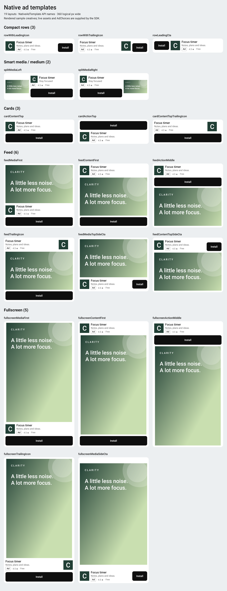

# Native Ads Guide

Declare a `NativePlacement` and mount `AdNativeView` to show native ads.
The engine registers 19 built-in native templates on Android and iOS.
Your application requires no Android XML layouts or iOS XIB factories.

## Template Selection Guide

Select a template matching your screen layout and visual hierarchy:

| Family | Key Templates | Initial Height Estimate | Best Use Case |
| :--- | :--- | :--- | :--- |
| **Compact row** | `rowWithLeadingIcon`, `rowWithTrailingIcon`, `rowLeadingCta` | 80 logical pixels | Search results, chat lists, compact table rows |
| **Smart media** | `splitMediaLeft`, `splitMediaRight` | 160 logical pixels | Grid feeds, e-commerce listings, article cards |
| **Card** | `cardContentTop`, `cardActionTop`, `cardContentTopTrailingIcon` | 132 logical pixels | Dashboard widgets, news summaries, medium cards |
| **Feed** | `feedMediaFirst`, `feedContentFirst`, `feedActionMiddle`, `feedTrailingIcon` | 340 logical pixels | Full-width social feeds, video feeds, photo streams |
| **Feed with side CTA** | `feedMediaTopSideCta`, `feedContentTopSideCta` | 280 logical pixels | Feed streams where call-to-action sits beside media |
| **Fullscreen** | `fullscreenMediaFirst`, `fullscreenContentFirst`, `fullscreenActionMiddle` | Full screen height ($\ge 320$) | Custom interstitial routes, full-page rewarded transitions |

Template presets provide standard defaults:
- `compactRow` = `rowWithLeadingIcon`
- `smartMedia` = `splitMediaLeft`
- `stackedCard` = `cardContentTop`
- `feedCard` = `feedMediaFirst`
- `fullscreen` = `fullscreenMediaFirst`



Template names describe the vertical arrangement of creative assets:
- **Row templates**: Keep the call-to-action button beside title and icon.
- **Smart media**: Places a 120-pixel-wide media view beside text and button.
- **Card templates**: Place title, body, and a full-width call-to-action button.
- **Feed templates**: Stack large media, advertiser identity, and call-to-action sequentially.
- **Fullscreen templates**: Expand to fill available height; your app must supply the dismiss button.

Missing optional assets collapse automatically.
The engine always shows advertiser attribution badges and AdChoices icons.

## Layout Bounds

Follow these constraints when mounting `AdNativeView`:

1. **Provide bounded width of at least 320 logical pixels**:
   AdMob native templates require 320 logical pixels minimum width.
   If parent constraints provide less than 320 pixels, or unbounded width, `AdNativeView` throws a `FlutterError`.

2. **Let content determine vertical height for inline templates**:
   `template.height` provides an initial loading estimate.
   The engine measures actual text lengths, font scales, and media aspect ratios dynamically.
   Do not wrap inline native ads in fixed-height containers.
   Use content-sized list items in scroll views.

3. **Provide bounded height of at least 320 logical pixels for fullscreen templates**:
   Fullscreen templates require bounded vertical space.
   Do not mount fullscreen templates directly inside an unbounded scroll axis.
   Place dismiss buttons outside the ad content area.

4. **Pass active state in retained pages**:
   When hosting native ads in `PageView` or `TabBarView`, pass `active: pageIndex == selectedIndex`.
   It defers the first request only; a hidden page keeps its ad and shows it again on return.
   Only active, measured fullscreen ads claim presentation ownership.

## Colors and Dynamic Styling

Configure native template appearance through `NativeAdStyle`.
Define initial styles in `NativePlacement.style` or global `AdmobKitConfig.nativeStyle`:

```dart
const blueNative = NativePlacement(
  id: 'blue_native',
  androidId: AdMobTestIds.nativeAndroid,
  iosId: AdMobTestIds.nativeIos,
  template: NativeAdTemplate.smartMedia,
  style: NativeAdStyle(
    background: 0xffffffff,
    headline: 0xff111111,
    body: 0xff555555,
    callToActionBackground: 0xff2563eb,
    callToActionText: 0xffffffff,
    callToActionCornerRadius: 8,
  ),
);
```

### Color Format

Colors use 32-bit unsigned ARGB integers (`0xAARRGGBB`):
- `background`: Container background color.
- `headline`: Title text color.
- `body`: Description, rating, and advertiser text color.
- `callToActionBackground`: Button fill color.
- `callToActionText`: Button label color.
- `callToActionCornerRadius`: Corner radius in logical pixels (defaults to 8).

### Live Style Updates

Update styling at runtime without reloading ads:

```dart
Future<void> useDarkNativeTheme() => AdmobKit.setNativeStyle(
  const NativeAdStyle(
    background: 0xff101010,
    headline: 0xfff5f5f5,
    body: 0xffbbbbbb,
    callToActionBackground: 0xfff5f5f5,
    callToActionText: 0xff101010,
    callToActionCornerRadius: 100,
  ),
);

Future<void> resetNativePlacement(NativePlacement placement) =>
    AdmobKit.setNativeStyle(const NativeAdStyle(), placement: placement);
```

Live updates apply immediately to cached, in-flight, and displayed ads.
To restore inherited styling on a specific placement, pass `const NativeAdStyle()`.

## Policy and Production Limits

Examine these AdMob policy constraints before releasing native ads:

1. **Character truncation limits**:
   AdMob policy requires at least 25 headline characters and 90 body characters before truncation occurs.
   Built-in templates use single-line text views with end ellipsis.
   At narrow widths or high system text scale, truncation can occur.
   Test your screens across multiple screen widths and device accessibility text scales.

2. **Attribution badge**:
   AdMob requires clear advertiser attribution.
   Built-in templates display the required attribution badge automatically.
   Do not cover, clip, or hide this badge.

3. **AdChoices icon**:
   Google requires an unobscured AdChoices icon.
   The SDK places this icon in the template corner.
   Keep app overlay elements away from template corners.
